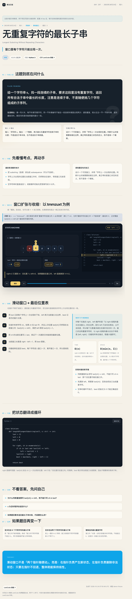
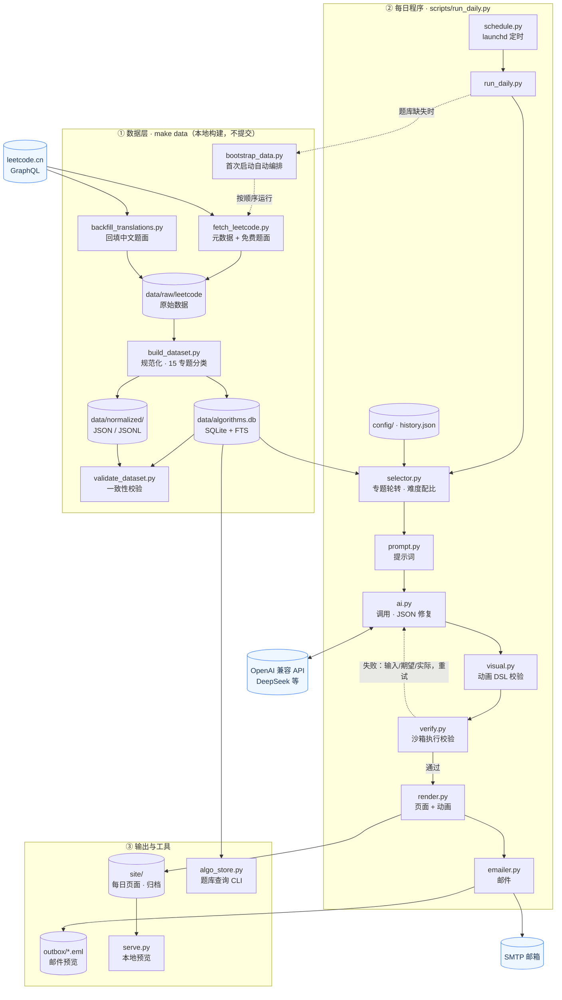
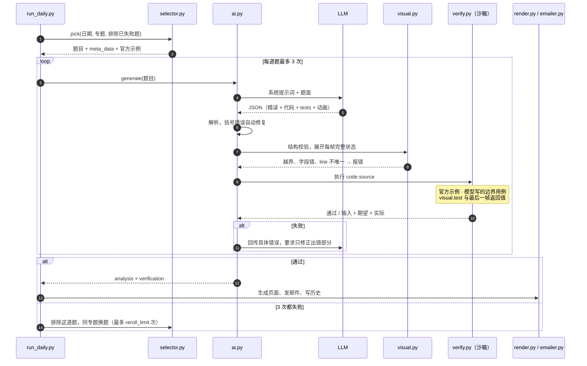

# 算法日报

每天从本地题库按覆盖约束抽一道算法题，生成一份中文精读 + 可交互 HTML 动画，并推送到邮箱。



## 第一步：构建题库

题库数据（`data/algorithms.db`、`data/normalized/`）不随仓库提交，第一次使用时在本地构建：

```bash
make data            # = python3 scripts/bootstrap_data.py
```

它会从 leetcode.cn 抓取公开题目数据（只抓免费题题面，付费题只记录元数据），然后离线规范化、生成 SQLite 并校验，通常几分钟；中断后重跑会从缓存续传。题库已存在时直接跳过。

- 不手动执行也可以：`run_daily.py`、`algo_store.py` 启动时发现没有题库会自动构建一次（`config/app.json` 里 `data.auto_bootstrap` 设为 `false` 可关闭）。
- `make data-check` 查看状态；`make refresh` 重新抓取最新题目并重建。
- `make refresh` 忽略元数据和题面批次缓存；普通抓取只复用 slug 集合完全匹配的批次。任一批次失败时返回非零，保留旧索引，不继续重建。
- 重建先在同一文件系统的临时目录生成全部 JSON 和 SQLite，再切换发布；写入失败不会先清空旧题库。JSON 与数据库无法跨文件整体原子切换，进程被强制中断时可能短暂不一致；`make data-check` 会检查构建时间、数量和必要文件，发现不完整后需重建。

## 先看效果

```bash
python3 scripts/run_daily.py --demo
python3 scripts/serve.py --open
```

打开 `http://127.0.0.1:8765/demo.html` 可以看到：

- 题目的「人话翻译」、生活类比、真正的考点；
- 可播放 / 上一步 / 下一步的 HTML 状态动画；
- Python 代码、复杂度、易错点、自检题；
- 一份可以直接打开的单文件 HTML；
- `data/daily/outbox/*.eml` 邮件预览。

邮件客户端大多不执行 JavaScript，所以邮件正文是**静态关键帧预览**；完整动画在**附件 HTML** 里，或者部署后的网页链接里。

## 启用真实每日推送

如果本机已有单词项目 `love`，可以直接复用它的凭据文件（推荐）：

```bash
# 读取 dev.love.daily.plist 里的“文件路径”，不读取密码内容
python3 scripts/reuse_love_config.py --write
python3 scripts/doctor.py
python3 scripts/run_daily.py --demo --send
python3 scripts/schedule.py install --time 08:00
```

从零配置则使用：

```bash
# 1. 本地交互式写入 .env（密钥不会打印到终端）
python3 scripts/setup.py

# 2. 检查配置
python3 scripts/doctor.py

# 3. 生成一次真实页面（先只写 .eml，不发信）
python3 scripts/run_daily.py --dry-run

# 4. 确认 .eml 正常后，真的发一封测试邮件
python3 scripts/run_daily.py --demo --send

# 5. 安装每天 08:00 的 macOS 定时任务
python3 scripts/schedule.py install --time 08:00
```

没有 `AI_API_KEY` 时只能跑 `--demo`；没有 SMTP 配置时会自动降级为 `.eml` 预览。详细配置、QQ / Gmail 授权码、定时任务和部署方式见 [docs/DAILY_APP.md](docs/DAILY_APP.md)。

## 数据概览

| 项目 | 数量 |
| --- | ---: |
| 题目索引（含付费题元数据） | 4,475 |
| 免费题完整题面 | 3,688（英文 3,409 + 中文 279） |
| 付费题元数据（无正文） | 787 |
| 进入 15 个算法专题 | 3,992 |
| 可被每日程序直接抽取（专题内 + 免费 + 有正文） | 3,465 |
| 待归类（LeetCode 尚未给标签） | 89 |
| 15 专题之外（SQL / Shell / 并发 / JS / Pandas） | 394 |

数据快照：2026-10-24（上表数字；自己构建时以 LeetCode 当时的题目为准，数量会略有不同）。分类是多标签的，同一道题可以同时属于「二分」和「动态规划」；`primary_topic` 只表示证据最强的那个专题。

## 15 个专题

| # | 专题 | 题目数 | 主分类数 | 有正文 |
| ---: | --- | ---: | ---: | ---: |
| 1 | 数组 · 字符串 · 哈希 | 3,242 | 726 | 2,817 |
| 2 | 双指针 · 滑动窗口 | 479 | 419 | 411 |
| 3 | 二分查找 | 380 | 218 | 330 |
| 4 | 栈 · 队列 · 单调栈 | 265 | 173 | 222 |
| 5 | 链表 | 114 | 52 | 98 |
| 6 | 二叉树 · BST | 318 | 286 | 249 |
| 7 | 图：BFS / DFS / 拓扑 / 并查集 / 最短路 | 374 | 295 | 308 |
| 8 | 堆 / 优先队列 | 240 | 105 | 204 |
| 9 | 回溯 | 139 | 107 | 119 |
| 10 | 动态规划 | 758 | 482 | 674 |
| 11 | 贪心 | 492 | 244 | 443 |
| 12 | 排序 | 590 | 162 | 511 |
| 13 | 位运算 | 329 | 134 | 296 |
| 14 | 基础数学 | 772 | 443 | 682 |
| 15 | 设计类 | 257 | 146 | 200 |

「数组」这类宽泛标签会让专题计数偏大，所以用 `primary_topic` 做主分类，用 `topic_ids` 保留所有关联专题，而不是强行一题一类。

## 架构

### 总览



### 生成与校验闭环

没有通过校验的内容不会发布：结构错误、代码错误、动画结论错误都会带着具体信息回传给模型重试；同一道题 3 次仍失败，就在同一专题内换题。



## 目录

```text
.
├── algo_store.py                  # 题库查询 API + 命令行
├── config/
│   ├── app.json                   # 每日程序配置（模型、时间、邮件选项）
│   └── topics.json                # 15 专题、标签权重、精选题、排除规则
├── data/                          # 均由 make data / 每日程序在本地生成，不提交
│   ├── algorithms.db              # SQLite 镜像（含全文检索）
│   ├── daily/                     # 每日分析 JSON、历史、邮件预览
│   ├── raw/leetcode/              # 抓取缓存：索引 + 免费题原始详情
│   └── normalized/
│       ├── index.json             # 全量紧凑索引
│       ├── index.jsonl            # 全量索引，一行一题
│       ├── problems/<slug>.json   # 3,688 道免费题的完整规范化记录
│       ├── by-topic/<topic>.json  # 15 个专题抽取文件
│       ├── topics.json            # 分类体系、标签权重、精选题
│       ├── pending-classification.json
│       ├── out-of-scope.json
│       └── manifest.json          # 数量、来源、许可证、文件说明
├── docs/
│   ├── DAILY_APP.md               # 每日程序配置与排错
│   ├── DATA_DICTIONARY.md
│   └── SOURCES.md
├── scripts/
│   ├── daily_app/                 # 选题、AI、渲染、邮件模块
│   ├── run_daily.py               # 每日主程序
│   ├── setup.py                   # 交互式写 .env
│   ├── doctor.py                  # 配置自检
│   ├── schedule.py                # macOS launchd 定时任务
│   ├── serve.py                   # 本地预览服务器
│   ├── bootstrap_data.py          # 首次构建题库（make data）
│   ├── fetch_leetcode.py          # 抓取/刷新
│   ├── backfill_translations.py   # 回填只有中文正文的题
│   ├── build_dataset.py           # 规范化 + 分类 + 导出 + SQLite
│   └── validate_dataset.py        # 一致性校验
├── site/                          # 生成的每日页面（不提交）
└── tests/                         # 数据 + 每日程序测试
```

## 快速开始

不需要安装任何 Python 依赖。

```bash
# 每日程序：先预览，再配置
python3 scripts/run_daily.py --demo
python3 scripts/serve.py --open

# 已有数据，直接校验
python3 scripts/validate_dataset.py

# 跑数据存储测试（不修改数据）
python3 -m unittest discover -s tests -v

# 查看统计
python3 algo_store.py stats

# 按专题抽取
python3 algo_store.py list --topic graph --difficulty Medium --free --with-statement --limit 10

# 只看中文题面
python3 algo_store.py list --lang zh --free --limit 10

# 随机抽一道专题内、免费、有正文的题
python3 algo_store.py random --topic dynamic-programming --free

# 查看一道题的完整记录
python3 algo_store.py show number-of-islands

# 导出为 JSONL，供别的程序消费
python3 algo_store.py export --topic binary-search --free --out work/binary-search.jsonl
```

刷新数据：

```bash
python3 scripts/fetch_leetcode.py --workers 6
python3 scripts/backfill_translations.py   # 补只有中文正文的题
python3 scripts/build_dataset.py
python3 scripts/validate_dataset.py
```

或者使用 `make`：

```bash
make build
make validate
make test
make stats
make refresh   # 重新抓取 + 构建 + 校验
```

## 程序里怎么用

```python
from algo_store import ProblemStore

with ProblemStore() as store:
    rows = store.list(
        topic="graph",
        difficulty="Medium",
        free=True,
        require_statement=True,
        limit=5,
    )
    print(rows[0]["title_zh"], rows[0]["slug"])

    problem = store.get(rows[0]["slug"])
    print(problem["statement"]["text"][:300])
    print(problem["topics"])
```

`store.list()` 返回紧凑元数据；`store.get()` 返回完整题面记录。也支持：

- `store.random(topic=..., difficulty=..., free=True)`
- `store.count(...)`
- `store.topics()`
- `store.tags()`
- `store.export_jsonl(rows, path)`

`search=` 保持字面子串匹配（`LIKE`），不把用户输入解释为 FTS 查询语法。
支持 FTS5 的 SQLite 构建还提供 `problems_fts`，供直接 SQL 查询使用，例如
`SELECT uid, title FROM problems_fts WHERE problems_fts MATCH 'island';`。
免费题的本地正文文件缺失时，`store.get()` 会返回元数据并在 `note` 中提示重建，而不是将其误报为付费题。

直接读文件也完全可以：

```python
import json

index = json.load(open("data/normalized/index.json"))
graph = json.load(open("data/normalized/by-topic/graph.json"))
problem = json.load(open("data/normalized/problems/number-of-islands.json"))
```

用 SQL：

```sql
-- 专题内、免费、有正文，按难度
SELECT p.frontend_id, p.title_zh, p.difficulty, p.slug
FROM problems p
JOIN problem_topics pt ON pt.problem_uid = p.uid
WHERE pt.topic_id = 'graph'
  AND p.paid_only = 0
  AND p.has_statement = 1
ORDER BY p.difficulty_level, p.uid
LIMIT 20;

-- 某专题里 AI 精选/常考候选
SELECT p.slug, p.title_zh, pt.score
FROM problems p
JOIN problem_topics pt ON pt.problem_uid = p.uid
WHERE pt.topic_id = 'dynamic-programming'
  AND pt.curated = 1
ORDER BY pt.score DESC;
```

## 分类规则

1. 每道题先看 LeetCode 标签，按 `config/topics.json` 里的 `tag_weights` 算分。
2. `must` 里的经典题额外加分，但不会凭精选身份抢到不相关的专题。
3. 一题可进多个专题；分数最高的是 `primary_topic`，其余保留在 `topic_ids`。
4. 处理了重叠噪声：
   - 纯树上的 BFS/DFS 不再因为 `depth-first-search` 被算进图专题；
   - 同时带 `tree` 和 `graph` 的混合题仍保留在两个专题；
   - `design` 不会因为栈题标签被误并入栈专题。
5. LeetCode 自己没挂标签的题不硬猜，放入 `pending-classification.json`。其中 56 道免费题有正文，33 道是付费题。
6. SQL / Shell / 并发 / JavaScript / Pandas 题保留在索引里，但不算进 15 个算法专题。

`classification_confidence` 是规则置信度：

- `high`：专题分 ≥ 4，且领先第二名 ≥ 1；
- `medium`：专题分 ≥ 2；
- `low`：只有数组/字符串这类宽泛标签兜底；
- `none`：没有算法专题。

## 付费题与版权

- 这份数据集只保存 **LeetCode 免费题正文**，付费题只保存标题、题号、难度、标签和官方链接，不绕过付费墙。
- 3,688 道免费题中，3,409 道正文为英文，279 道只有中文正文的题已回填中文（`statement.lang = "zh"`）。
- 免费题正文、示例、代码模板仍属于 LeetCode；这里只用于本机个人学习，不应公开分发或商用。**仓库里不包含任何题面数据**，题库由使用者在本地用 `make data` 自行构建。
- 完整说明见 [docs/SOURCES.md](docs/SOURCES.md)。

## 许可证

本仓库的代码与文档以 [MIT License](LICENSE) 发布，Copyright (c) 2026 out-of-energy。

MIT 只覆盖本仓库的源代码与文档；通过 `make data` 在本地获取的 LeetCode 题面、示例和代码模板版权归 LeetCode 所有，不在此许可范围内。

## 下一步

当前已经能每天自动生成页面、发邮件。接下来可以按需要加：

1. 部署到 GitHub Pages / Cloudflare Pages，让邮件里的链接直接打开；
2. 接入其他 OJ 或 GitHub 题单的 source adapter；
3. 根据错题记录做复习队列；
4. 增加 Java / C++ 代码版本。

字段与表结构见 [docs/DATA_DICTIONARY.md](docs/DATA_DICTIONARY.md)，每日程序配置见 [docs/DAILY_APP.md](docs/DAILY_APP.md)，存储测试说明见 [tests/README.md](tests/README.md)。

## 测试结果

`python3 -m unittest discover -s tests -v`：共 113 个测试。覆盖索引/JSONL/专题文件/SQLite 对账、付费题零正文、中文题面回填、分类规则可重放、查询 API、30 天与 120 天专题轮转、动画场景 DSL 校验与状态继承、代码执行校验（官方示例 / 边界用例 / 动画结论）、JSON 修复、HTML 转义、邮件 dry-run 与附件，以及发送失败重试、批次缓存失配、重建失败回滚与就绪检查。没有本地题库时，数据相关测试会跳过，20 个纯逻辑测试照常运行。
